# 实验室管理系统

> 🎓 **计算机毕业设计 · 实验室管理系统**
>
> 本仓库只放**项目介绍 + 运行截图**（截图是站点带水印的原图，存在仓库 `images/` 里）。
>
> 👉 **完整可运行源码 / 数据库脚本 / 部署文档：[点我获取](https://geekcode.top/archives/%E5%AE%9E%E9%AA%8C%E5%AE%A4%E7%AE%A1%E7%90%86%E7%B3%BB%E7%BB%9F?utm_source=github)**
>
> 💬 咨询微信：**ir9372**　|　🌐 更多项目：[极客代码 geekcode.top](https://geekcode.top/?utm_source=github)
>
> 📌 项目详情页：<https://geekcode.top/archives/%E5%AE%9E%E9%AA%8C%E5%AE%A4%E7%AE%A1%E7%90%86%E7%B3%BB%E7%BB%9F?utm_source=github>

<table><td width="230" align="center"> <b>扫码加微信 ir9372</b></td><td valign="middle">📦 源码 = 项目介绍 + 全部运行截图 + 数据库 + 部署文档 👉 点上方任意截图，直接跳到 <b>极客代码 geekcode.top</b> 详情页</td></table>

---

<h1>实验室管理系统</h1>
<h2>项目概述</h2>

本项目为“实验室管理系统”，旨在解决高校或科研机构中实验室资源管理分散、设备借用流程繁琐及信息沟通不畅的问题。系统采用前后端分离架构，基于 Spring Boot 后端与 Vue 前端技术栈构建，实现了从前台用户交互到后台数据管理的完整闭环。核心功能涵盖实验室预约申请、设备报备与申领、消耗品领取、在线论坛交流及新闻资讯发布等模块。适用人群包括普通师生（用户）、实验室管理员及系统超级管理员。通过数字化手段优化资源配置，提升实验室管理效率，确保设备流转可追溯，同时提供便捷的社区交流平台以增强用户互动性。

<h2>技术架构</h2>
<h3>1. 总体架构设计</h3>

系统采用典型的 B/S（Browser/Server）架构模式，分为表现层、业务逻辑层和数据持久层。前端负责页面渲染与用户交互，后端处理业务请求并返回 JSON 数据，数据库负责数据存储与管理。

<a href="https://geekcode.top/archives/%E5%AE%9E%E9%AA%8C%E5%AE%A4%E7%AE%A1%E7%90%86%E7%B3%BB%E7%BB%9F?utm_source=github" title="查看完整源码">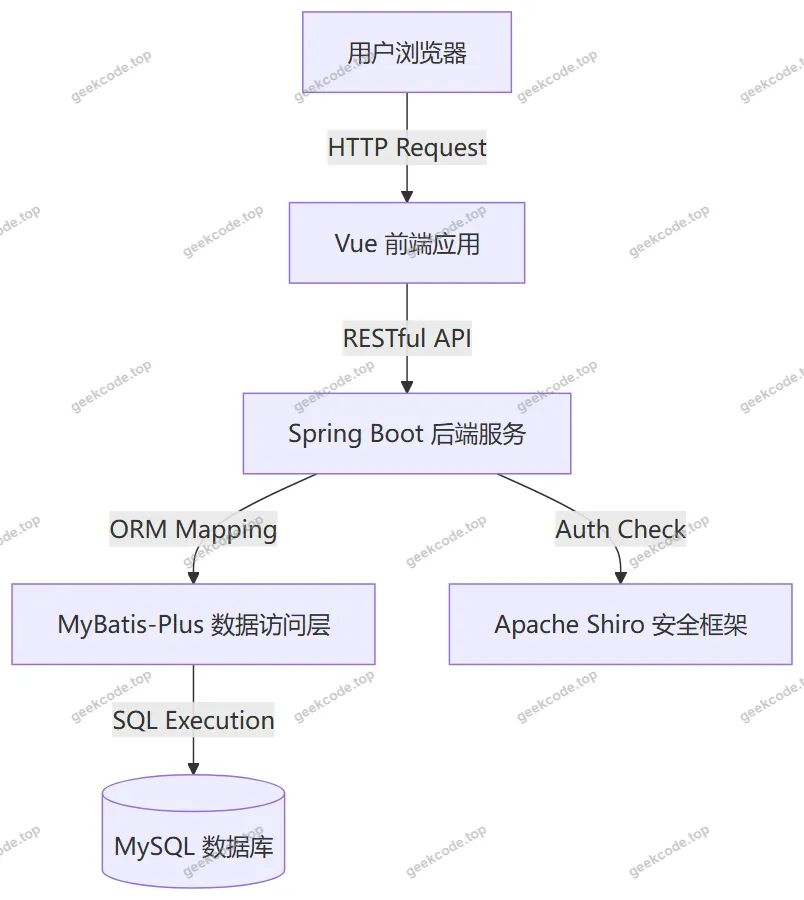</a>

<h3>2. 核心技术选型理由</h3>
<ul>
<li><strong>后端框架 (Spring Boot)</strong>：利用其自动配置和起步依赖特性，快速搭建稳定、高效的后端服务环境，简化了传统 Spring 应用的配置复杂度。</li>
<li><strong>持久层框架 (MyBatis-Plus)</strong>：在 MyBatis 基础上提供了强大的 CRUD 封装和条件构造器，大幅减少了样板代码，提升了开发效率，同时支持灵活的分页查询和动态 SQL 生成。</li>
<li><strong>安全框架 (Apache Shiro)</strong>：用于实现细粒度的权限控制和身份认证。Shiro 轻量级且易于集成，能够有效保护接口安全，区分不同角色用户的访问权限。</li>
<li><strong>数据库 (MySQL)</strong>：作为主流的关系型数据库，具备高可靠性、高性能和良好的事务支持，适合存储结构化业务数据如用户信息、设备状态、申请记录等。</li>
<li><strong>前端技术 (Vue.js)</strong>：虽然具体版本未在上下文中明确，但结合 <code>vue-integrated</code> 类型推断，使用 Vue 框架构建响应式单页应用（SPA），实现前后端数据的高效交互与组件化开发。</li>
</ul>
<h3>3. 数据库设计要点</h3>

数据库主要围绕实体关系进行设计，核心表结构包括：

<ul>
<li><strong>用户表 (<code>yonghu</code> / <code>defaultuser</code>)</strong>：存储用户基本信息、账号密码及角色标识。</li>
<li><strong>实验室表 (<code>shiyanshi</code>)</strong>：记录实验室名称、位置、容量及当前状态。</li>
<li><strong>设备表 (<code>shebei</code>)</strong>：包含设备名称、型号、所属实验室、可用数量及维护状态。</li>
<li><strong>消耗品表 (<code>xiaohaopin</code>)</strong>：管理实验耗材的名称、库存量及规格。</li>
<li><strong>申请与报备表</strong>：</li>
<li><code>shiyanshishenqing</code>：实验室使用申请表。</li>
<li><code>shebeishenqing</code>：设备借用申请表。</li>
<li><code>shebeibaobei</code>：设备故障或损坏报备表。</li>
<li><code>xiaohaopinlingqu</code>：消耗品领取记录表。</li>
<li><strong>内容管理表</strong>：</li>
<li><code>forum</code>：论坛帖子信息。</li>
<li><code>news</code>：新闻资讯内容。</li>
<li><strong>其他辅助表</strong>：<code>config</code>（系统配置）、<code>adminexam</code>（管理员考试相关，视截图而定）、<code>chat</code>（客服聊天记录）。</li>
</ul>
<h2>功能模块</h2>
<h3>1. 前台用户端功能</h3>

前台面向普通注册用户，提供信息查询、资源申请及社区互动服务。

<ul>
<li><strong>首页展示</strong>：轮播图展示最新通知或热门资源，导航栏入口清晰。</li>
<li><strong>实验室管理</strong>：</li>
<li><strong>列表浏览</strong>：查看全校/全所实验室的基本信息。</li>
<li><strong>详情查看</strong>：了解实验室开放时间、容纳人数及设备清单。</li>
<li><strong>在线申请</strong>：提交实验室使用申请，填写用途、时间段等信息。</li>
<li><strong>设备管理</strong>：</li>
<li><strong>设备查询</strong>：按类别或名称搜索可用设备。</li>
<li><strong>设备详情</strong>：查看设备参数、图片及使用说明。</li>
<li><strong>设备申请</strong>：发起设备借用申请，等待审批。</li>
<li><strong>设备报备</strong>：上报设备故障或使用异常，便于及时维修。</li>
<li><strong>消耗品管理</strong>：</li>
<li><strong>消耗品列表</strong>：查看各类实验耗材及其库存状态。</li>
<li><strong>消耗品详情</strong>：获取耗材规格、单价及领用规则。</li>
<li><strong>领取申请</strong>：提交消耗品领取单据。</li>
<li><strong>资讯与论坛</strong>：</li>
<li><strong>新闻资讯</strong>：阅读实验室管理规定、科研动态或通知公告。</li>
<li><strong>论坛信息</strong>：发布帖子、回复评论，与其他用户交流实验心得或问题求助。</li>
<li><strong>个人中心</strong>：</li>
<li><strong>基本资料</strong>：修改头像、昵称、联系方式等个人信息。</li>
<li><strong>我的发布</strong>：查看自己发布的论坛帖子、提交的各类申请记录及审核状态。</li>
<li><strong>客服聊天</strong>：内置即时通讯模块，用户可直接联系管理员咨询问题。</li>
</ul>
<h3>2. 后台管理端功能</h3>

后台面向管理员，提供全面的数据管理与业务审批功能。

<ul>
<li><strong>系统首页</strong>：展示关键数据统计概览（如待办事项、今日申请数等）。</li>
<li><strong>实验室管理 (<code>/shiyanshi</code>)</strong>：增删改查实验室基础信息，设置开放策略。</li>
<li><strong>实验室申请审核 (<code>/shiyanshishenqing</code>)</strong>：查看用户提交的实验室预约，执行批准或驳回操作。</li>
<li><strong>设备管理 (<code>/shebei</code>)</strong>：录入新设备，更新设备状态（正常/维修/报废），分配所属实验室。</li>
<li><strong>设备申请审核 (<code>/shebeishenqing</code>)</strong>：处理设备借用请求，确认出库或拒绝。</li>
<li><strong>设备报备处理 (<code>/shebeibaobei</code>)</strong>：接收故障报告，安排维修任务，记录处理结果。</li>
<li><strong>消耗品管理 (<code>/xiaohaopin</code>)</strong>：维护耗材目录，调整库存数量。</li>
<li><strong>消耗品领取审核 (<code>/xiaohaopinlingqu</code>)</strong>：审批领用申请，扣减库存，生成领用记录。</li>
<li><strong>论坛管理 (<code>/forum</code>)</strong>：监控论坛内容，删除违规帖子，置顶优质讨论。</li>
<li><strong>新闻资讯管理 (<code>/news</code>)</strong>：发布、编辑、删除新闻公告，控制前台显示顺序。</li>
<li><strong>用户管理 (<code>/yonghu</code>)</strong>：查看注册用户列表，重置密码，禁用违规账号。</li>
<li><strong>客服管理 (<code>/kefuguanli</code>)</strong>：实时回复用户咨询，查看历史聊天记录。</li>
<li><strong>轮播图管理 (<code>/config</code> 或相关路由)</strong>：上传和管理首页展示的轮播图片，配置链接跳转。</li>
<li><strong>管理员考试/考核 (<code>/adminexam</code>)</strong>：根据路由存在此模块，可能涉及管理员自身的业务技能考核或题库管理（具体功能细节需结合源码进一步确认，此处仅列路由对应模块）。</li>
</ul>
<h2>用户角色与权限</h2>

系统主要划分为两类角色：<strong>普通用户</strong>和<strong>管理员</strong>。权限控制通过 Apache Shiro 框架实现。

<table>
<thead>
<tr>
<th align="left">角色</th>
<th align="left">描述</th>
<th align="left">可访问功能模块</th>
</tr>
</thead>
<tbody><tr>
<td align="left"><strong>普通用户</strong></td>
<td align="left">注册登录后的师生或科研人员</td>
<td align="left"><strong>前台全部功能</strong>：1. 浏览实验室、设备、消耗品、新闻、论坛。2. 提交实验室申请、设备申请、设备报备、消耗品领取。3. 发布论坛帖子、评论。4. 使用个人中心（修改信息、查看我的发布）。5. 参与客服聊天。</td>
</tr>
<tr>
<td align="left"><strong>管理员</strong></td>
<td align="left">拥有最高权限的系统维护人员</td>
<td align="left"><strong>后台全部功能 + 前台部分管理视角</strong>：1. 所有数据的 CRUD（增删改查）操作。2. 审批所有类型的申请（实验室、设备、消耗品）。3. 处理故障报备。4. 管理用户账户状态。5. 发布和维护新闻、论坛内容。6. 配置系统参数（如轮播图）。7. 响应客服消息。</td>
</tr>
</tbody></table>

<em>注：根据路由 <code>/adminexam</code> 推测可能存在“超级管理员”或特定考核角色，但在常规业务流中，上述两角色已覆盖核心权限体系。若存在细分角色（如教师、学生），其权限差异主要体现在数据可见范围上，例如教师可能只能审批本课题组学生的申请，但现有上下文未明确此类层级隔离逻辑，故统一归为管理员权限范畴。</em>

<h2>项目特色与创新点</h2>
<ol>
<li>
<strong>全流程闭环管理</strong>：
   不同于简单的信息展示系统，本项目实现了从“资源发现 -&gt; 在线申请 -&gt; 后台审批 -&gt; 状态反馈”的完整业务闭环。特别是针对设备和消耗品的双重管控（申请+报备/领取），确保了实物资产的可追溯性。

</li>
<li>
<strong>多维度的资源分类体系</strong>：
   将实验室空间、精密仪器（设备）、低值易耗品（消耗品）三类不同性质的资源进行独立建模与管理。这种分类符合高校实验室实际管理痛点，避免了单一表格管理带来的混乱。

</li>
<li>
<strong>集成化的社区交流机制</strong>：
   内置论坛模块，打破了传统管理系统仅作为“工具”的定位，构建了“工具+社区”的双向生态。用户可以在遇到问题时先在论坛求助，或通过客服直接连接管理员，增强了系统的粘性和实用性。

</li>
<li>
<strong>基于 Shiro 的安全防护</strong>：
   引入成熟的 Apache Shiro 框架，实现了细粒度的权限控制和会话管理，保障了敏感数据（如用户隐私、审批记录）的安全性，防止越权访问。

</li>
<li>
<strong>前后端分离的现代化架构</strong>：
   采用 Spring Boot + Vue 的技术组合，使得界面交互更加流畅，用户体验更佳。同时，清晰的 RESTful API 设计便于后续扩展移动端应用或对接其他校内信息系统。

</li>
</ol>
<h2>部署环境</h2>

为确保系统正常运行，需准备以下软件环境：

<ol>
<li><strong>操作系统</strong>：Windows 10/11, Linux (CentOS 7+/Ubuntu 20.04+) 或 macOS。</li>
<li><strong>Java 运行环境</strong>：JDK 1.8 或 JDK 11（推荐 JDK 8，兼容大多数 Spring Boot 2.x 版本）。</li>
<li><strong>数据库服务器</strong>：MySQL 5.7 或 MySQL 8.0。需安装并启动服务，创建对应的数据库实例。</li>
<li><strong>构建工具</strong>：</li>
</ol>
<ul>
<li><strong>Maven</strong>：3.6+，用于管理后端 Java 依赖及打包。</li>
<li><strong>Node.js</strong>：14.x 或 16.x LTS 版本，配合 npm 或 yarn 用于前端项目的依赖安装与编译打包。</li>
</ul>
<ol start="5">
<li><strong>Web 服务器</strong>：</li>
</ol>
<ul>
<li>后端：内置 Tomcat（由 Spring Boot Starter Web 提供）。</li>
<li>前端：Nginx 或 Apache HTTP Server（用于托管编译后的静态文件），或在开发阶段使用 Vue CLI 自带的 Dev Server。</li>
</ul>
<ol start="6">
<li><strong>浏览器</strong>：Chrome, Firefox, Edge 等现代主流浏览器（建议开启 JavaScript 支持）。</li>
</ol>
<h2>五、技术特性</h2>
<ul>
<li>前后端集成部署，前端资源打包至后端 static 目录</li>
<li>使用 MyBatis-Plus 简化数据访问层开发</li>
<li>集成 Shiro 权限框架实现角色权限控制</li>
</ul>
<h2>六、功能模块截图</h2>
<h3>前台用户端</h3>
<h4>前台首页</h4>

<a href="https://geekcode.top/archives/%E5%AE%9E%E9%AA%8C%E5%AE%A4%E7%AE%A1%E7%90%86%E7%B3%BB%E7%BB%9F?utm_source=github" title="查看完整源码">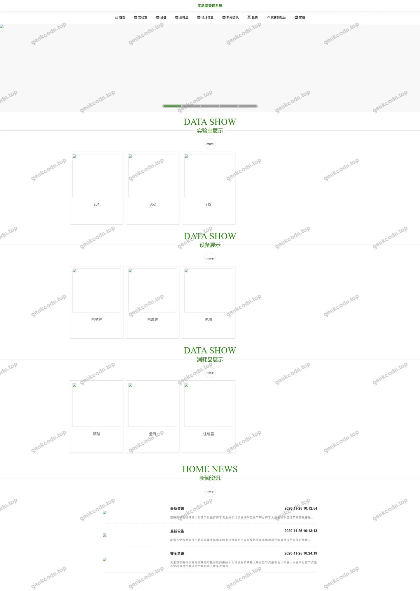</a>

<h4>前台注册页</h4>

<h4>前台登录页</h4>

<a href="https://geekcode.top/archives/%E5%AE%9E%E9%AA%8C%E5%AE%A4%E7%AE%A1%E7%90%86%E7%B3%BB%E7%BB%9F?utm_source=github" title="查看完整源码">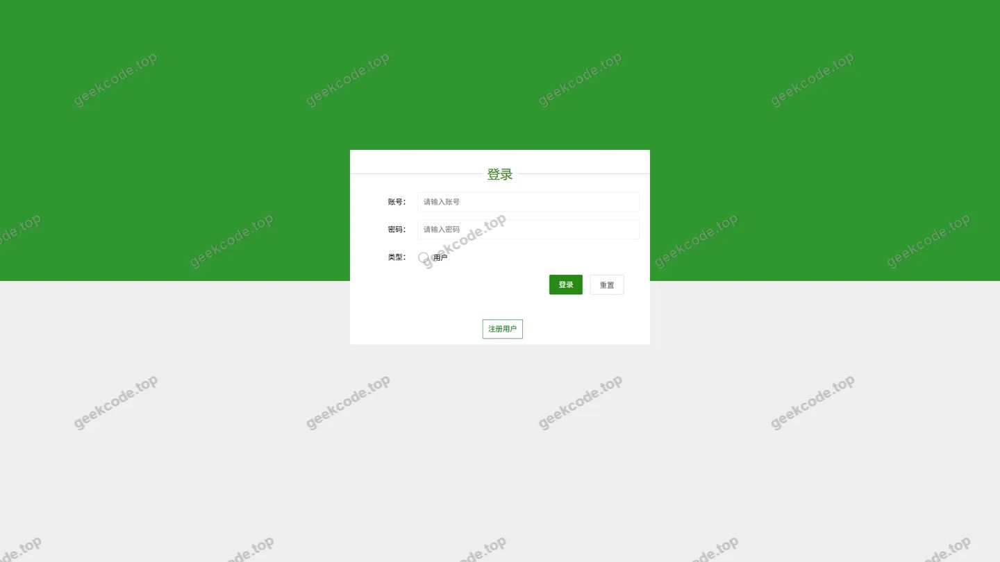</a>

<h4>前台注册页</h4>

<h4>前台-论坛信息列表</h4>

<a href="https://geekcode.top/archives/%E5%AE%9E%E9%AA%8C%E5%AE%A4%E7%AE%A1%E7%90%86%E7%B3%BB%E7%BB%9F?utm_source=github" title="查看完整源码">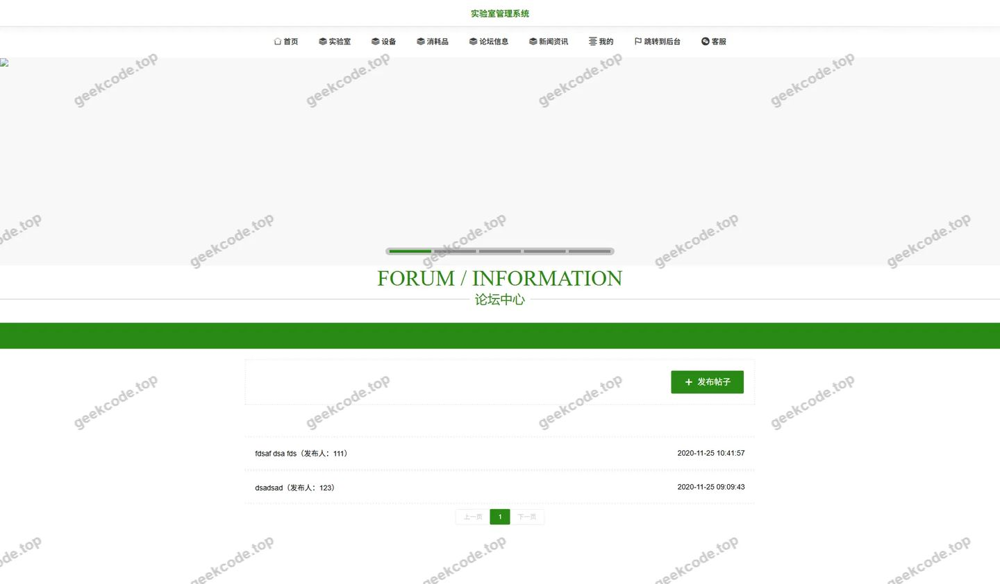</a>

<h4>前台-新闻资讯列表</h4>

<a href="https://geekcode.top/archives/%E5%AE%9E%E9%AA%8C%E5%AE%A4%E7%AE%A1%E7%90%86%E7%B3%BB%E7%BB%9F?utm_source=github" title="查看完整源码">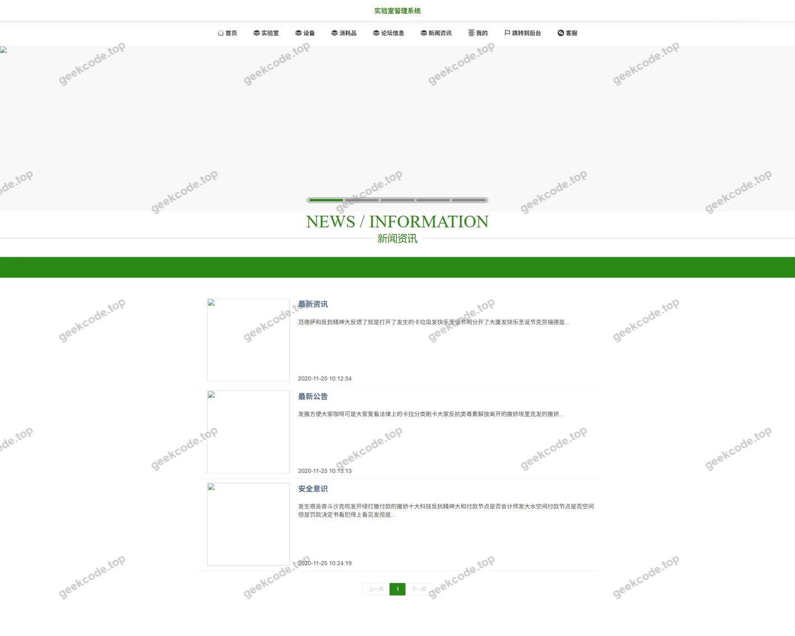</a>

<h4>前台-设备列表</h4>

<a href="https://geekcode.top/archives/%E5%AE%9E%E9%AA%8C%E5%AE%A4%E7%AE%A1%E7%90%86%E7%B3%BB%E7%BB%9F?utm_source=github" title="查看完整源码">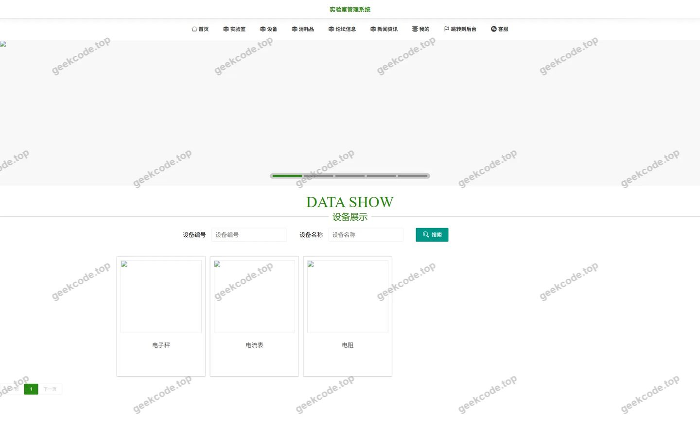</a>

<h4>前台-实验室列表</h4>

<a href="https://geekcode.top/archives/%E5%AE%9E%E9%AA%8C%E5%AE%A4%E7%AE%A1%E7%90%86%E7%B3%BB%E7%BB%9F?utm_source=github" title="查看完整源码">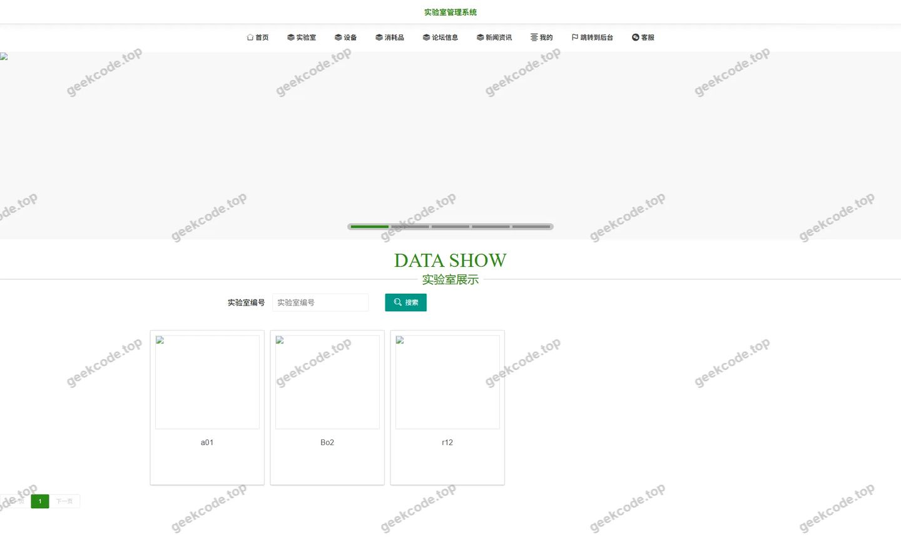</a>

<h4>前台-消耗品列表</h4>

<a href="https://geekcode.top/archives/%E5%AE%9E%E9%AA%8C%E5%AE%A4%E7%AE%A1%E7%90%86%E7%B3%BB%E7%BB%9F?utm_source=github" title="查看完整源码">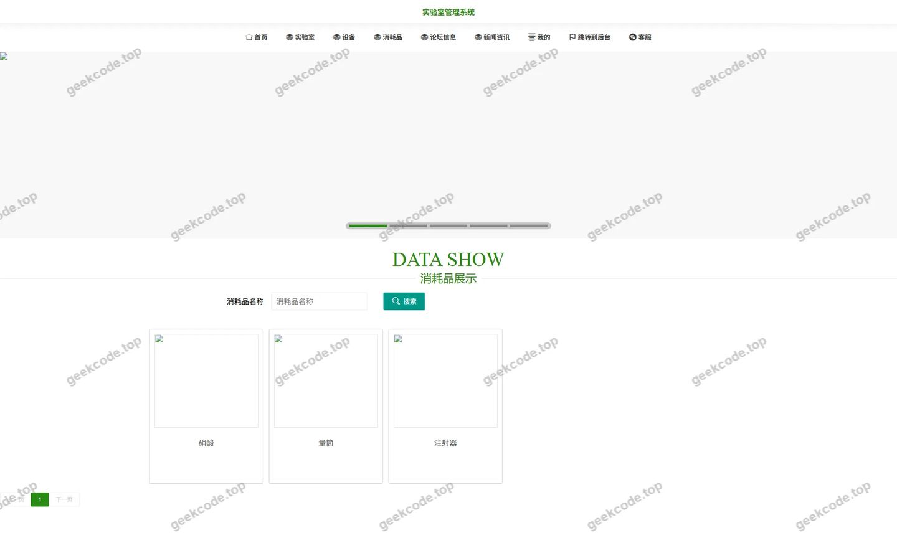</a>

<h4>前台-收货地址列表</h4>

<a href="https://geekcode.top/archives/%E5%AE%9E%E9%AA%8C%E5%AE%A4%E7%AE%A1%E7%90%86%E7%B3%BB%E7%BB%9F?utm_source=github" title="查看完整源码">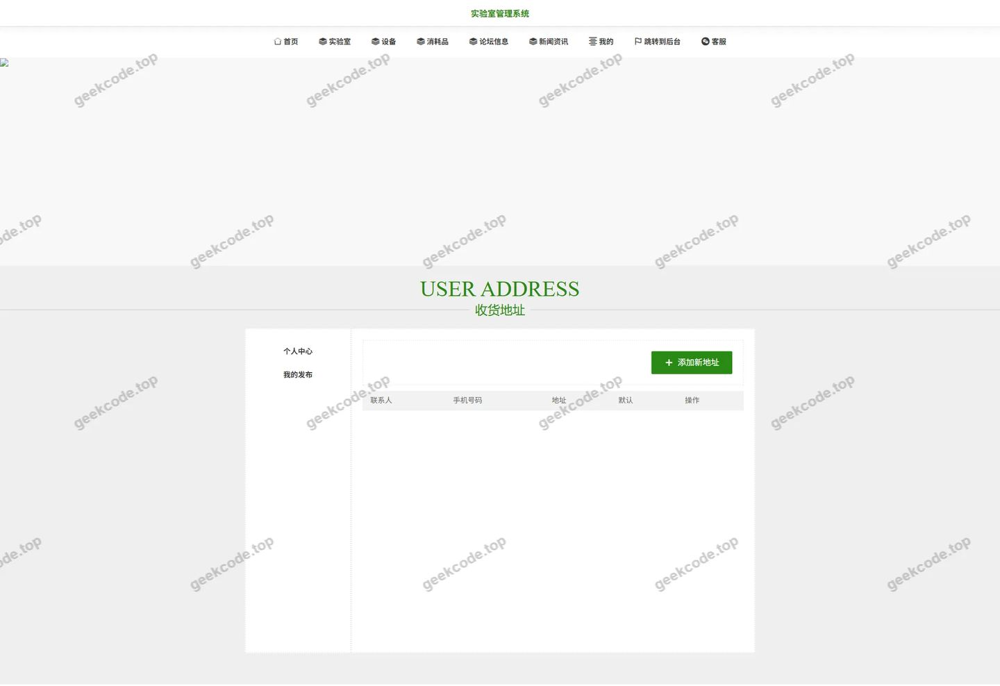</a>

<h4>前台-购物车列表</h4>

<a href="https://geekcode.top/archives/%E5%AE%9E%E9%AA%8C%E5%AE%A4%E7%AE%A1%E7%90%86%E7%B3%BB%E7%BB%9F?utm_source=github" title="查看完整源码">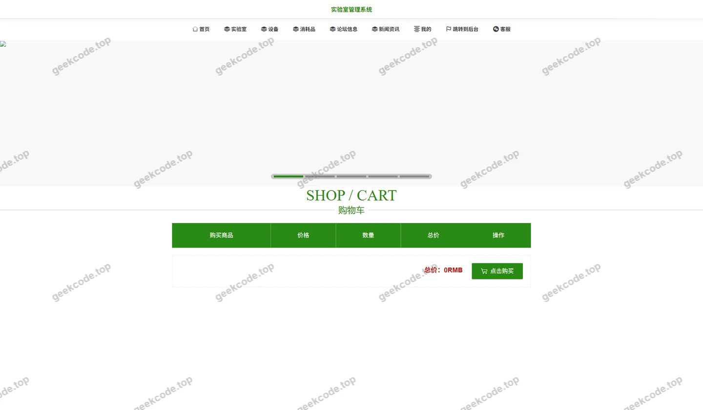</a>

<h4>前台-错题本</h4>

<h4>前台-默认用户</h4>

<h4>前台-试卷</h4>

<a href="https://geekcode.top/archives/%E5%AE%9E%E9%AA%8C%E5%AE%A4%E7%AE%A1%E7%90%86%E7%B3%BB%E7%BB%9F?utm_source=github" title="查看完整源码">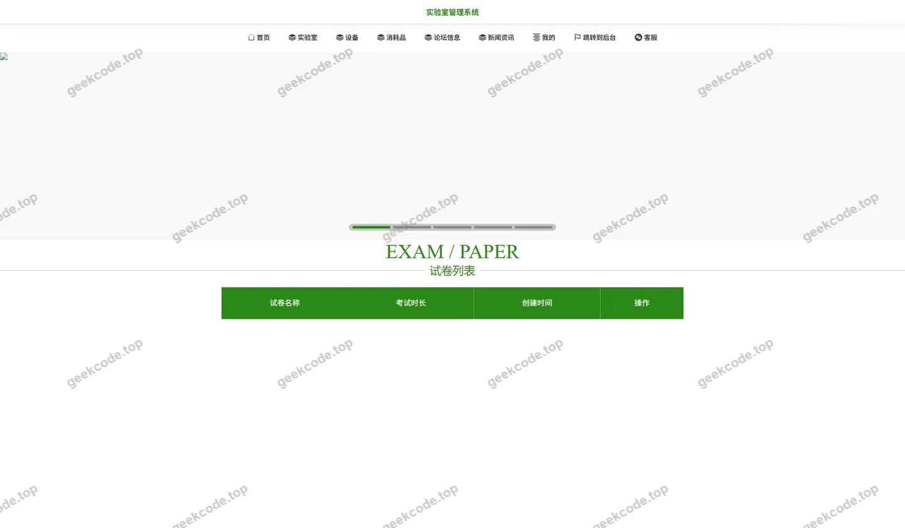</a>

<h4>前台-试题</h4>

<a href="https://geekcode.top/archives/%E5%AE%9E%E9%AA%8C%E5%AE%A4%E7%AE%A1%E7%90%86%E7%B3%BB%E7%BB%9F?utm_source=github" title="查看完整源码">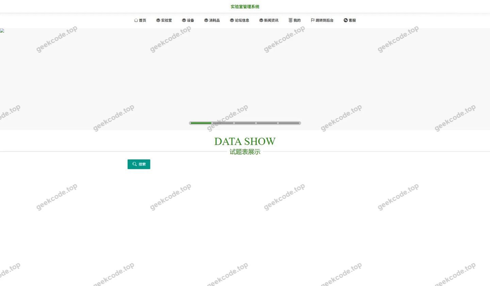</a>

<h4>前台-考试记录</h4>

<a href="https://geekcode.top/archives/%E5%AE%9E%E9%AA%8C%E5%AE%A4%E7%AE%A1%E7%90%86%E7%B3%BB%E7%BB%9F?utm_source=github" title="查看完整源码">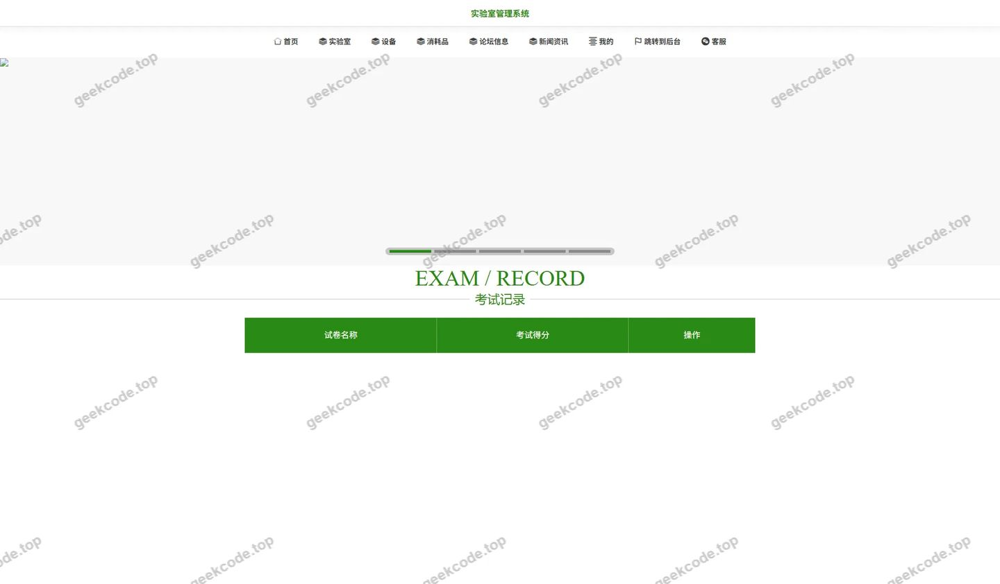</a>

<h4>前台个人中心</h4>

<a href="https://geekcode.top/archives/%E5%AE%9E%E9%AA%8C%E5%AE%A4%E7%AE%A1%E7%90%86%E7%B3%BB%E7%BB%9F?utm_source=github" title="查看完整源码">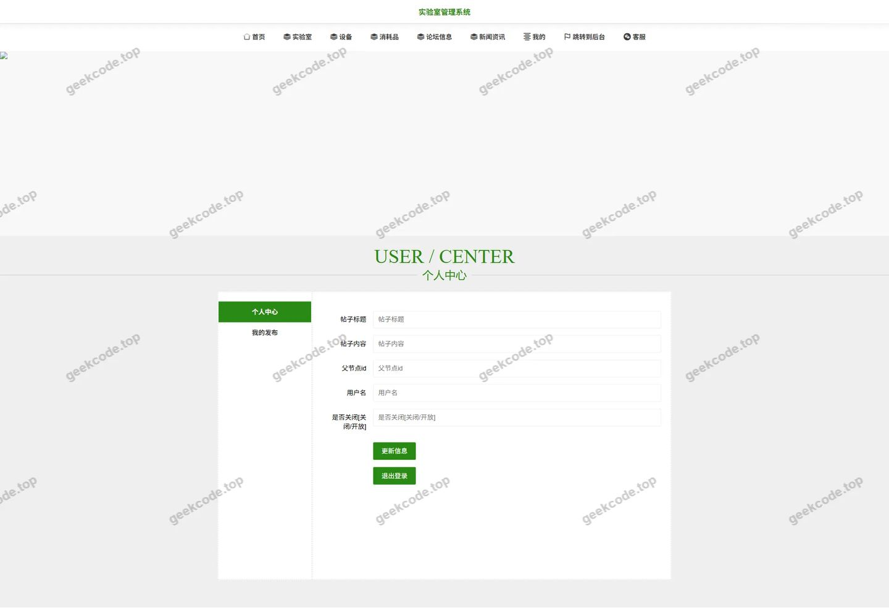</a>

<h4>前台个人中心</h4>

<a href="https://geekcode.top/archives/%E5%AE%9E%E9%AA%8C%E5%AE%A4%E7%AE%A1%E7%90%86%E7%B3%BB%E7%BB%9F?utm_source=github" title="查看完整源码">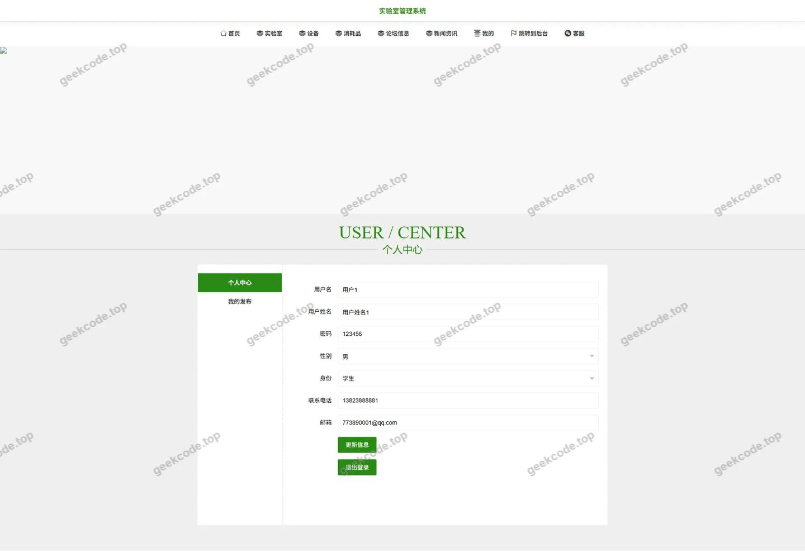</a>

<h4>前台-论坛信息-详情</h4>

<a href="https://geekcode.top/archives/%E5%AE%9E%E9%AA%8C%E5%AE%A4%E7%AE%A1%E7%90%86%E7%B3%BB%E7%BB%9F?utm_source=github" title="查看完整源码">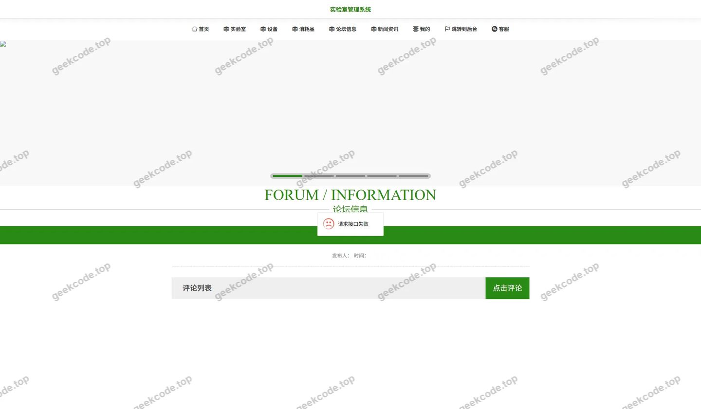</a>

<h4>前台-新闻资讯-详情</h4>

<h4>前台-设备-详情</h4>

<a href="https://geekcode.top/archives/%E5%AE%9E%E9%AA%8C%E5%AE%A4%E7%AE%A1%E7%90%86%E7%B3%BB%E7%BB%9F?utm_source=github" title="查看完整源码">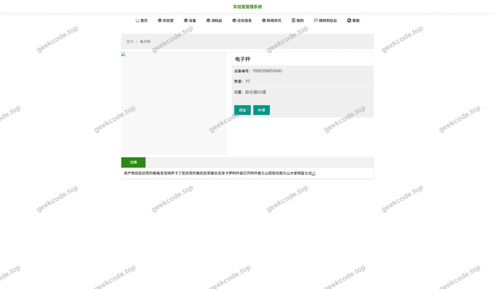</a>

<h4>前台-实验室-详情</h4>

<a href="https://geekcode.top/archives/%E5%AE%9E%E9%AA%8C%E5%AE%A4%E7%AE%A1%E7%90%86%E7%B3%BB%E7%BB%9F?utm_source=github" title="查看完整源码">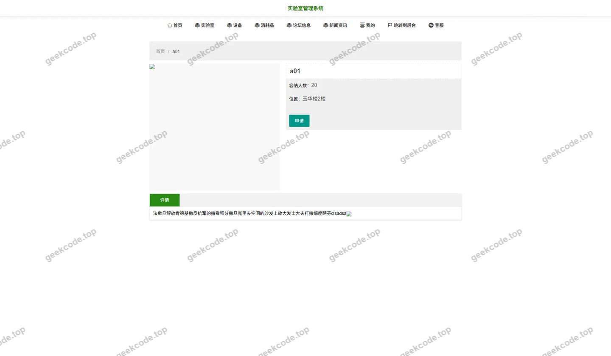</a>

<h4>前台-消耗品-详情</h4>

<a href="https://geekcode.top/archives/%E5%AE%9E%E9%AA%8C%E5%AE%A4%E7%AE%A1%E7%90%86%E7%B3%BB%E7%BB%9F?utm_source=github" title="查看完整源码">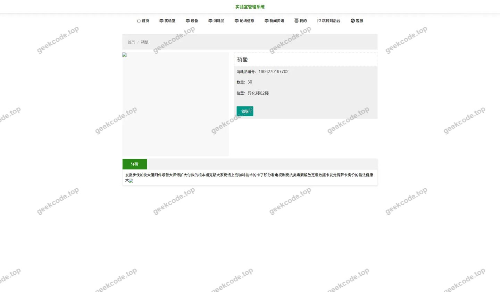</a>

<h4>前台-客服聊天列表</h4>

<a href="https://geekcode.top/archives/%E5%AE%9E%E9%AA%8C%E5%AE%A4%E7%AE%A1%E7%90%86%E7%B3%BB%E7%BB%9F?utm_source=github" title="查看完整源码">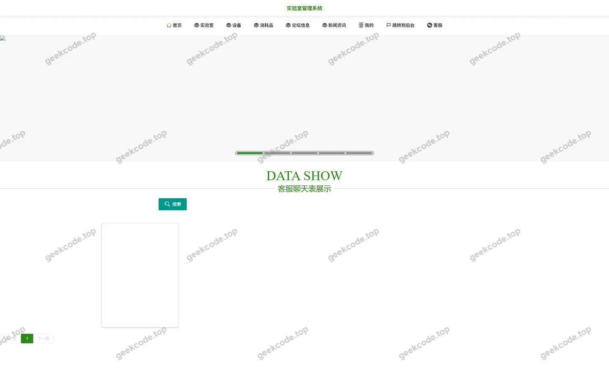</a>

<h3>后台管理端</h3>
<h4>后台-系统配置</h4>

<a href="https://geekcode.top/archives/%E5%AE%9E%E9%AA%8C%E5%AE%A4%E7%AE%A1%E7%90%86%E7%B3%BB%E7%BB%9F?utm_source=github" title="查看完整源码">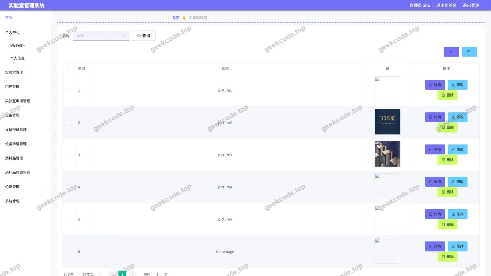</a>

<h4>后台-论坛</h4>

<a href="https://geekcode.top/archives/%E5%AE%9E%E9%AA%8C%E5%AE%A4%E7%AE%A1%E7%90%86%E7%B3%BB%E7%BB%9F?utm_source=github" title="查看完整源码">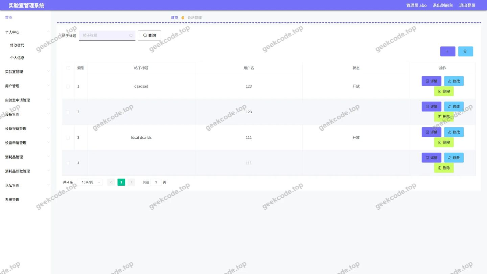</a>

<h4>后台首页</h4>

<a href="https://geekcode.top/archives/%E5%AE%9E%E9%AA%8C%E5%AE%A4%E7%AE%A1%E7%90%86%E7%B3%BB%E7%BB%9F?utm_source=github" title="查看完整源码">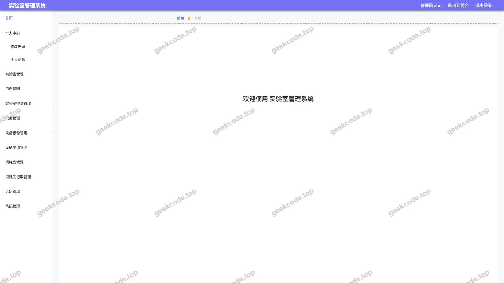</a>

<h4>后台-客服管理</h4>

<a href="https://geekcode.top/archives/%E5%AE%9E%E9%AA%8C%E5%AE%A4%E7%AE%A1%E7%90%86%E7%B3%BB%E7%BB%9F?utm_source=github" title="查看完整源码">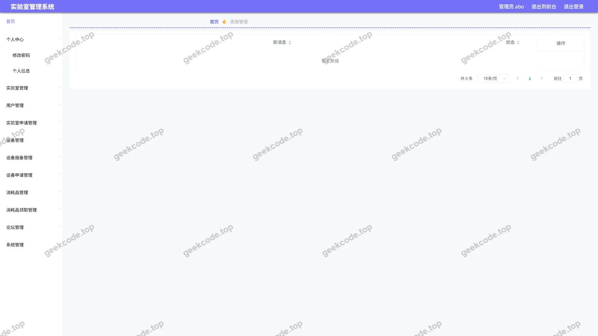</a>

<h4>后台-登录</h4>

<h4>后台-公告信息</h4>

<a href="https://geekcode.top/archives/%E5%AE%9E%E9%AA%8C%E5%AE%A4%E7%AE%A1%E7%90%86%E7%B3%BB%E7%BB%9F?utm_source=github" title="查看完整源码">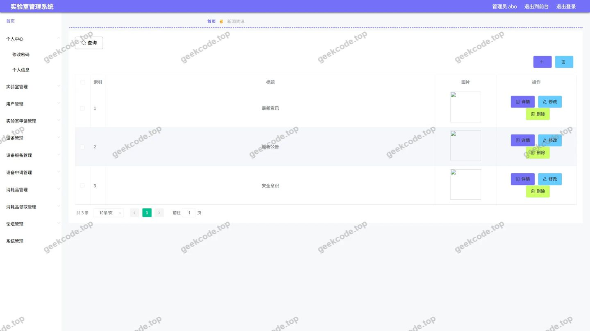</a>

<h4>后台-设备</h4>

<a href="https://geekcode.top/archives/%E5%AE%9E%E9%AA%8C%E5%AE%A4%E7%AE%A1%E7%90%86%E7%B3%BB%E7%BB%9F?utm_source=github" title="查看完整源码">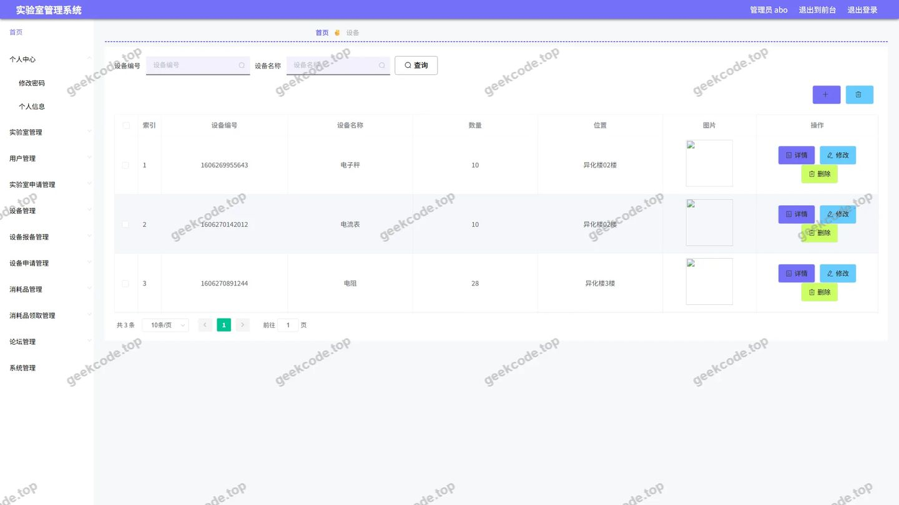</a>

<h4>后台-设备报备</h4>

<a href="https://geekcode.top/archives/%E5%AE%9E%E9%AA%8C%E5%AE%A4%E7%AE%A1%E7%90%86%E7%B3%BB%E7%BB%9F?utm_source=github" title="查看完整源码">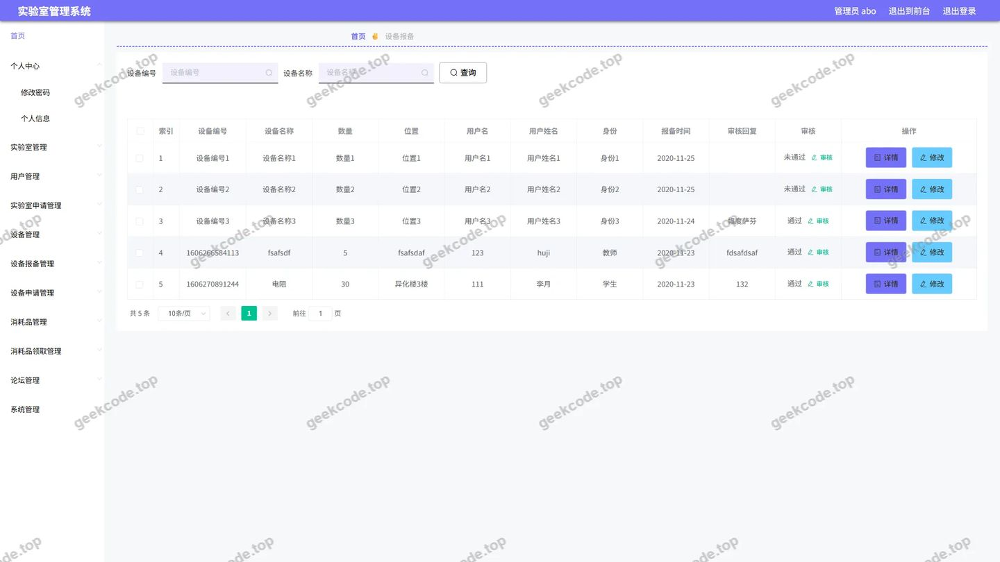</a>

<h4>后台-设备申请</h4>

<a href="https://geekcode.top/archives/%E5%AE%9E%E9%AA%8C%E5%AE%A4%E7%AE%A1%E7%90%86%E7%B3%BB%E7%BB%9F?utm_source=github" title="查看完整源码">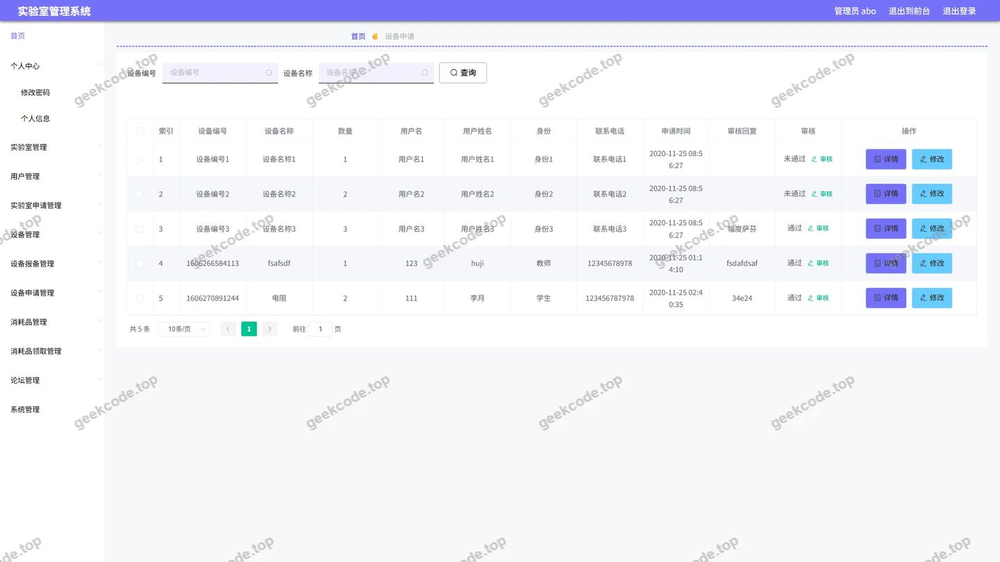</a>

<h4>后台-实验室</h4>

<a href="https://geekcode.top/archives/%E5%AE%9E%E9%AA%8C%E5%AE%A4%E7%AE%A1%E7%90%86%E7%B3%BB%E7%BB%9F?utm_source=github" title="查看完整源码">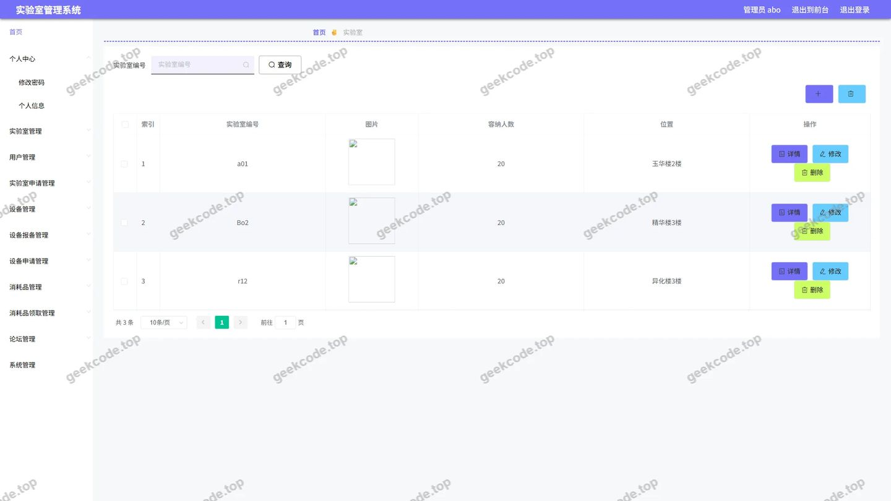</a>

<h4>后台-实验室申请</h4>

<a href="https://geekcode.top/archives/%E5%AE%9E%E9%AA%8C%E5%AE%A4%E7%AE%A1%E7%90%86%E7%B3%BB%E7%BB%9F?utm_source=github" title="查看完整源码">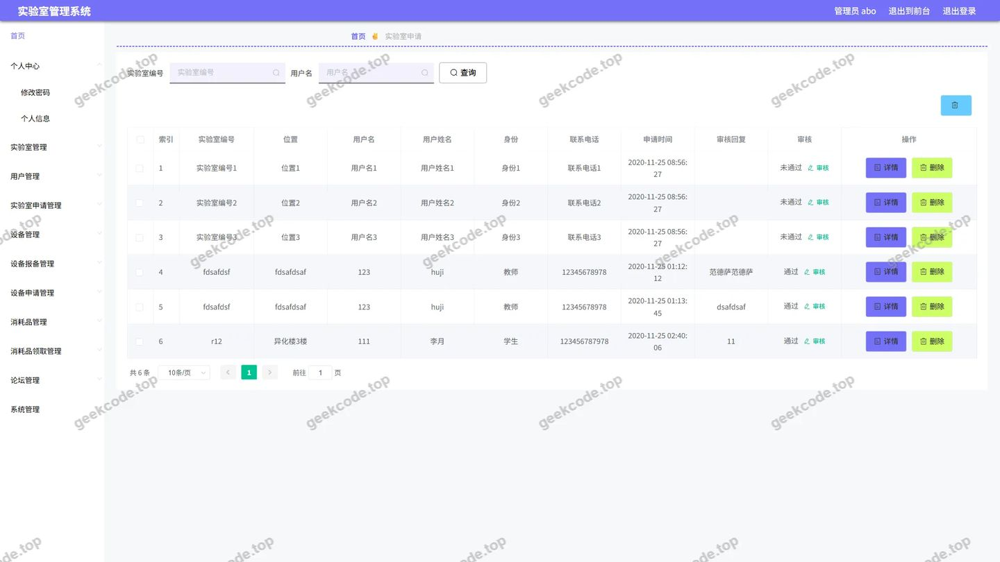</a>

<h4>后台-消耗品</h4>

<a href="https://geekcode.top/archives/%E5%AE%9E%E9%AA%8C%E5%AE%A4%E7%AE%A1%E7%90%86%E7%B3%BB%E7%BB%9F?utm_source=github" title="查看完整源码">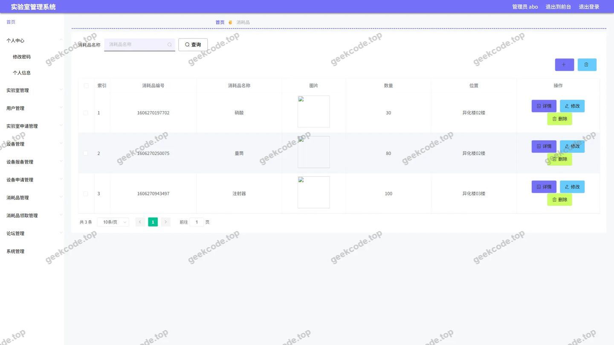</a>

<h4>后台-消耗品领取</h4>

<a href="https://geekcode.top/archives/%E5%AE%9E%E9%AA%8C%E5%AE%A4%E7%AE%A1%E7%90%86%E7%B3%BB%E7%BB%9F?utm_source=github" title="查看完整源码">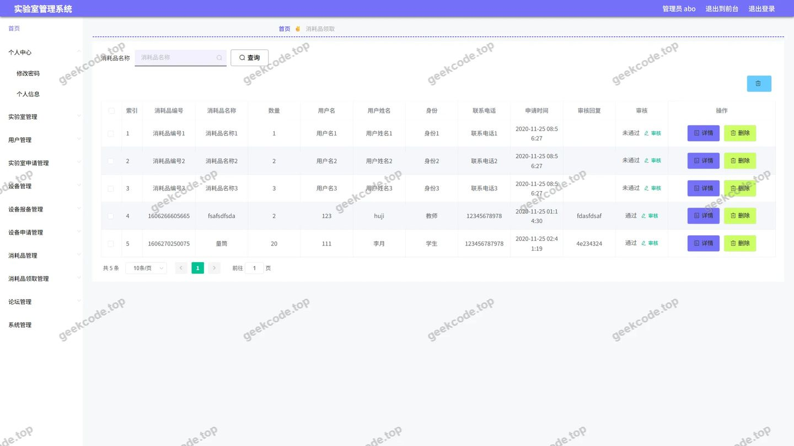</a>

---

## 获取完整源码

| 项目 | 说明 |
| --- | --- |
| 项目名 | 实验室管理系统 |
| 运行截图 | 本文 38 张（站点带水印原图，仓库 `images/` 目录） |
| 完整源码 | [https://geekcode.top/archives/%E5%AE%9E%E9%AA%8C%E5%AE%A4%E7%AE%A1%E7%90%86%E7%B3%BB%E7%BB%9F?utm_source=github](https://geekcode.top/archives/%E5%AE%9E%E9%AA%8C%E5%AE%A4%E7%AE%A1%E7%90%86%E7%B3%BB%E7%BB%9F?utm_source=github) |
| 咨询微信 | **ir9372**（备注：jingpin-yuanma） |
| 更多项目 | [极客代码 geekcode.top](https://geekcode.top/?utm_source=github) |

> 需要源码、部署、改配置、跑不起来等问题，加微信 ir9372 沟通，说明项目名即可。
